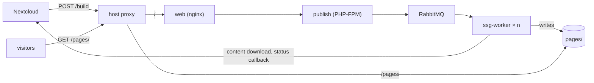

What happens between a build request and a published site, and the rules publish and ssg-worker
share.

## Overview



| Component | Runs as | Does |
| --- | --- | --- |
| host proxy | nginx or any proxy on the host | Terminates TLS. Forwards `/` to `web`, serves build pages via `/pages/` |
| `web` | nginx container | Passes every request to PHP-FPM in `publish` over FastCGI |
| `publish` | PHP-FPM container | Checks the bearer token and the request, puts a `BuildJob` on `q.builds`, answers `202` |
| RabbitMQ | `rabbitmq:4` container | Holds `q.builds`, and the `delays` exchange for the worker's retry |
| `ssg-worker` | PHP CLI containers, `SSG_WORKER_REPLICAS` of them, default 2 | Takes one job at a time: downloads, renders, swaps the site into `pages/`, calls back |

## Authentication

`POST /build` requires `Authorization: Bearer <PUBLISH_API_TOKEN>`. The scheme is case-sensitive,
and the token may contain `A-Z a-z 0-9 - _ + ~ / .` with optional trailing `=`; hex, base64 and
base64url all qualify.

- A firewall in `config/packages/security.yaml` checks the token. Its one `access_control` rule
  requires `ROLE_API` for every path, so a new endpoint is protected unless that file says
  otherwise.
- The check runs on `kernel.request`, before the controller: a malformed body without a token is a
  `401`. Routing runs earlier, so an unknown path is a `404`.
- `/health` has `security: false`, so a probe with a stale `Authorization` header still gets `200`.
- `/auth-verification` answers `200` only with a valid token, so Collectives can test its URL and
  token before sending builds. A missing or wrong token is a `401`.
- A blank `PUBLISH_API_TOKEN` answers every request with `401`. An unset one cannot be resolved,
  so a request with a token gets a `500`. Either way nothing is enqueued.

## Validation

publish checks every field of a build request; the
[API reference](https://nextcloud-publish.github.io/publish/) lists the rules. ssg-worker does not
check them again and uses `static_site_id`, `slug` and `build_id` as directory names, so publish
is the only check.

## The build message

`BuildController` dispatches an `App\Message\BuildJob` through
[Symfony Messenger](https://symfony.com/doc/current/messenger.html).
`config/packages/messenger.yaml` routes it to the `builds` transport, which publishes it to the
default exchange with `q.builds` as the routing key. publish has no handler for it.

The body is JSON from Messenger's `symfony_serializer`; the class's property names are the keys:

```json
{ "build_id": "...", "static_site_id": "...", "slug": "...", "title": "...",
  "content_download_url": "...", "callback_status_url": "...", "created_at": "..." }
```

`build_id` is a UUID v7 publish generates per request. Messenger adds a `type` header with the
class name and `X-Message-Stamp-*` headers.

ssg-worker decodes the body into its own `App\Message\BuildJob`, found by the `type` header. Both
classes have the same namespace, name and properties, and every property is required, so they
change together; a message that does not decode is dropped without a callback.

## RabbitMQ

The broker creates the `publish` user, `q.builds` and the `delays` exchange from
`definitions.json` when it starts. Neither service declares anything (`auto_setup: false`).
publish answers `202` only after the broker confirms the message.

## The build

ssg-worker takes one message at a time: it downloads the archive, extracts it, renders the pages
with [ssg-library](https://github.com/nextcloud-publish/ssg-library), and swaps the site into
`pages/<static_site_id>/<slug>/`. Then it PUTs the outcome to `callback_status_url`.

| Outcome | What happens |
| --- | --- |
| Success | the site goes live, `published` with the `publish_url` is reported |
| Transient failure | retried once after 15s through the `delays` exchange; a second failure reports `failed` |
| Permanent failure | reported `failed` at once: an archive without a Markdown page, or a callback answered with a 3xx or a 4xx other than 408 and 429 |

The callback body is `{"status": "published", "data": {"publish_url": ...}}` or
`{"status": "failed", "data": {"error_message": ...}}`. Delivery is at-least-once, so Nextcloud
must treat a repeated status as one.

[build-pipeline.md](https://github.com/nextcloud-publish/ssg-worker/blob/main/docs/build-pipeline.md)
in ssg-worker describes the directories, the swap and the retries in detail.
